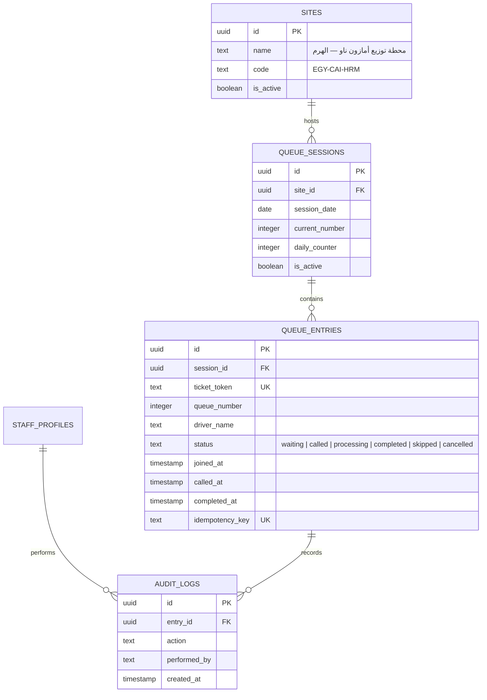

# ⚡ Amazon Now — QR-Based Delivery Queue Management System
### محطة توزيع أمازون ناو — الهرم (Al-Haram Hub, Giza, Egypt)

[](https://nextjs.org/)
[](https://www.typescriptlang.org/)
[](https://tailwindcss.com/)
[](https://supabase.com/)
[](tests/queue-workflow.test.ts)

A production-ready, mobile-first QR delivery queue management system built for **Amazon Now Distribution Hub — Al-Haram, Giza, Egypt** (**محطة توزيع أمازون ناو — الهرم**). Designed specifically for rapid fulfillment couriers and warehouse dispatchers, featuring **100% natural Egyptian Arabic (العامية المصرية)**, strict right-to-left (RTL) typography, atomic concurrency locking, a mandatory 5-minute driver rest cooldown, shift session controls, and authentic Amazon Now aesthetics.

---

## 📸 System Overview & Live Interfaces

| Interface | Route | Primary Audience | Description |
| :--- | :--- | :--- | :--- |
| **Driver Scan & Join** | `/` | Couriers / Drivers | Mobile-optimized one-tap queue entrance. Zero sign-up, mandatory courier name, real-time closed session banner. |
| **Private Live Ticket** | `/ticket/[token]` | Couriers / Drivers | Large dynamic queue number, people ahead, real-time status updates, audio chime & vibration alert. |
| **Staff Operations Dashboard** | `/staff` | Warehouse Dispatchers | Shift session controls (Open/Close queue & Reset counter), FIFO driver calling (`نده على اللي بعده`), preparation tracking, and order completion. |
| **Public TV Monitor Display** | `/display` | Waiting Bay Screen | Digital signage for warehouse waiting area with huge current-turn numbers and automated sound alert. |
| **Printable QR Poster** | `/staff/qr` | Station Admins | Permanent location QR code manager with high-res PNG download and A4 printable poster generator. |
| **Order History** | `/staff/history` | Dispatch Supervisors | Completed order records with local Cairo timestamps (`Africa/Cairo`) and instant search. |
| **Audit Logs** | `/staff/audit` | Station Compliance | Comprehensive audit trail of every staff action (call, prep, finish, skip, cancel, session toggle). |
| **Staff Authentication** | `/staff/login` | Station Staff | Supabase Auth login with 1-click demo access for local staging. |

---

## 🌟 Key Features & Business Rules

### 1. 📱 Frictionless Driver Journey (Mobile-First)
- **One Permanent QR Code:** Attached at the warehouse entry bay.
- **Zero App Installation & No Sign-Up:** Couriers scan using their standard smartphone camera.
- **Mandatory Driver Name:** Couriers enter their name or badge code so dispatchers can call them at the counter. (Shipment / tracking number field removed per operational flow).
- **One Giant High-Contrast Button:** Prominent **"ادخل الطابور"** button designed for one-handed thumb tapping on motorbike or van arrival.

### 2. 🚦 Shift Session Management & Station Control (New)
- **Open / Close Reception:** Warehouse dispatchers can toggle the queue open or closed (`فتح استقبال المناديب` / `إغلاق الطابور مؤقتاً`) at any time directly from the top of the `/staff` dashboard.
- **Instant Driver Notice:** When closed, the driver screen automatically disables the join button and displays a high-visibility closed banner: `الطابور مغلق حالياً (استقبال المناديب متوقف)`.
- **Start New Shift Session (`بدء جلسة جديدة - تصفير العداد`):** Dispatchers can reset the daily counter back to 0 with one click, beginning a fresh shift where the next driver receives ticket `#001` while preserving historical records.
- **Server-Side Validation:** Requests to `/api/queue/join` during a closed session are rejected with HTTP `403 Forbidden` (`session_closed: true`).

### 3. ⏱️ 5-Minute Mandatory Cooldown (Rest & Fairness Enforced)
- Once a courier completes their order pickup, a **5-minute (300 seconds) mandatory cooldown** is enforced.
- Prevents queue hoarding and promotes fair rotation among all drivers.
- **Dual Enforcement:**
  - **Client-Side:** The join button is locked into a countdown timer displaying `برجاء الانتظار (MM:SS)` with clear Egyptian instructions.
  - **Server-Side:** `/api/queue/join` checks the driver's previous ticket and rejects requests before the 300-second mark with HTTP `429 Too Many Requests`.

### 4. 🔒 Atomic Concurrency & Idempotency
- **No Duplicate Numbers:** Queue number allocation uses PostgreSQL row-level locks (`FOR UPDATE`) inside a database function (`join_queue_atomic`).
- **Network Retry & Double-Tap Protection:** Every join request carries an `idempotency_key` generated on the client. Rapid double-taps return the existing ticket safely without incrementing the queue.
- **FIFO Staff Calling:** Dispatchers call drivers using `FOR UPDATE SKIP LOCKED` to prevent race conditions when multiple staff members call drivers simultaneously.

### 5. 🔔 Dynamic Audio Chime, Vibration & Realtime Alerts
- **Zero External Audio Assets:** Synthesizes a pleasant two-tone warehouse chime (880Hz -> 1320Hz) directly in the browser via the **Web Audio API**.
- **Haptic Feedback:** Vibrates mobile devices via the **HTML5 Vibration API** when the driver's number is called.
- **Celebratory Confetti:** Triggers celebration confetti on the driver's screen upon being summoned to the pickup window.

### 6. 🎨 Authentic Amazon Now Branding
- **Official Brand Mark:** High-resolution electric blue icon (`#0071dc`) with white lowercase "amazon", "now" with electric lightning bolt in the "o", and the iconic Amazon smile curve.
- **Al-Haram Hub Badge:** Distinctive **محطة توزيع أمازون ناو — الهرم** identifier with a pulsing amber status indicator.
- **Color Palette:**
  - `Electric Blue`: `#0071dc`
  - `Midnight Navy`: `#090d16` & `#0f172a`
  - `Amazon Gold/Amber`: `#f59e0b` & `#ff9900`
  - `Emerald Success`: `#10b981`
  - `Rose Alert`: `#f43f5e`
- **Typography:** Google `Cairo` font with full bidirectional RTL (`dir="rtl"`) layout and LTR-protected digital counters.

---

## 🏗️ Architecture & Technology Stack

```
amazon-now-delivery-queue/
├── src/
│   ├── app/                          # Next.js 16 App Router
│   │   ├── page.tsx                  # Driver QR entry page (Name + Join + Cooldown)
│   │   ├── layout.tsx                # RTL root layout with Cairo font
│   │   ├── globals.css               # Tailwind CSS v4 styling & animations
│   │   ├── ticket/[token]/page.tsx   # Courier's private live ticket
│   │   ├── staff/                    # Warehouse staff interfaces
│   │   │   ├── page.tsx              # Live operations dashboard
│   │   │   ├── history/page.tsx      # Daily order history & search
│   │   │   ├── audit/page.tsx        # System audit logs
│   │   │   ├── qr/page.tsx           # Permanent QR manager & A4 printable poster
│   │   │   └── login/page.tsx        # Staff authentication
│   │   ├── display/page.tsx          # Public TV monitor waiting bay screen
│   │   └── api/queue/                # Resilient REST API endpoints
│   │       ├── join/route.ts         # Join queue (with 5-min cooldown & idempotency)
│   │       ├── ticket/[token]/route.ts # Fetch live ticket details
│   │       ├── active/route.ts       # Active waiting/called/processing queue
│   │       ├── action/route.ts       # Staff state transitions (call, prep, complete, skip, cancel)
│   │       ├── stats/route.ts        # Real-time counter metrics
│   │       ├── history/route.ts      # Daily completed logs
│   │       └── audit/route.ts        # System audit records
│   ├── components/                   # Modular UI components
│   │   ├── AmazonNowLogo.tsx         # Official Amazon Now logo & Al-Haram hub badge
│   │   ├── LiveClock.tsx             # Real-time Cairo digital clock
│   │   ├── StaffNav.tsx              # Staff navigation header
│   │   └── StatusBadge.tsx           # Egyptian Arabic status badges
│   ├── lib/
│   │   ├── audio.ts                  # Web Audio API chime & haptics
│   │   ├── date-format.ts            # Cairo timezone formatting & numeral padding
│   │   ├── queue-service.ts          # Queue engine with Supabase & resilient fallback
│   │   └── supabase/                 # Client & Admin Supabase SDK instances
│   └── types/
│       └── queue.ts                  # TypeScript data contracts & statuses
├── supabase/
│   ├── schema.sql                    # One-click Supabase SQL Editor schema
│   └── migrations/
│       └── 20261011_initial_schema.sql # Complete DDL, RLS policies & stored procedures
├── tests/
│   └── queue-workflow.test.ts        # Automated concurrency & workflow test suite
└── public/
    └── images/
        └── amazon-now-logo.png       # Official Amazon Now brand asset
```

---

## 🗄️ Database Design & Supabase Schema

The schema handles high-concurrency ordering, session resets, and real-time pub/sub:



### Stored Procedures
- `join_queue_atomic`: Obtains a `FOR UPDATE` lock on the active `queue_sessions` record, verifies the `idempotency_key`, increments the `daily_counter`, and generates a secure 48-character `ticket_token`.
- `call_next_driver`: Locates the oldest `waiting` driver using `FOR UPDATE SKIP LOCKED`, updates status to `called`, and appends an entry to `audit_logs`.
- `update_queue_entry_status`: Transitions ticket state between `called`, `processing`, `completed`, `skipped`, and `cancelled` with full timestamp tracking.

---

## 🗣️ Egyptian Arabic (العامية المصرية) UI Glossary

The entire interface is written in natural, welcoming Egyptian Arabic:

| English Term | UI Term (العامية المصرية) | Context / Meaning |
| :--- | :--- | :--- |
| **Join Queue** | **ادخل الطابور** | The primary CTA button for couriers |
| **Queue Number** | **رقمك في الطابور** | Large ticket number (e.g. `001`) |
| **Queue Position** | **ترتيبك في الطابور** | Current rank in line |
| **Couriers Ahead** | **قبلك كام واحد** | Number of drivers before your turn |
| **Waiting** | **مستني دورك** | Status badge for drivers awaiting call |
| **Called / Ready** | **دورك جه! اتفضل استلم طلبك** | Urgent summons banner & notification |
| **Processing** | **جاري تجهيز طلبك دلوقتي** | Warehouse staff assembling the order |
| **Completed** | **تم استلام الطلب بنجاح!** | Order completed, triggers 5-min cooldown |
| **Call Next** | **نده على اللي بعده** | Dispatcher FIFO summons button |
| **Re-call** | **نده عليه تاني** | Re-alert driver if they didn't arrive |
| **Skip** | **تخطي الدور** | Move unresponsive driver aside |
| **Cancel** | **إلغاء الدور** | Remove erroneous entry |
| **Rest Cooldown** | **فترة راحة إلزامية: ٥ دقائق** | 5-minute cooldown notice |
| **Wait (MM:SS)** | **برجاء الانتظار (MM:SS)** | Countdown timer displayed on disabled button |
| **Al-Haram Hub** | **محطة توزيع أمازون ناو — الهرم** | Hub branding across all views |

---

## 🛠️ Production Challenges, Error Handling & Engineering Post-Mortem

During production hardening and staging runs for high-throughput courier fulfillment at the Al-Haram hub, several critical edge cases and runtime bottlenecks were uncovered and resolved. Below is a detailed engineering breakdown of the errors encountered, root cause investigations, and production-grade solutions implemented:

---

### 1. Shift Session Counter Reset Blocked (`بدء جلسة جديدة - تصفير العداد`)

* **Issue / Symptom:**  
  Warehouse supervisors reported that clicking **"بدء جلسة جديدة (تصفير العداد)"** on mobile devices and warehouse tablets appeared unresponsive or failed to reset the counter back to `#001`. In some instances, previously served drivers from older shifts lingered in the active waiting queue.
* **Root Cause Analysis:**  
  1. **Mobile WebView & Browser Dialog Suppression:** The original handler used synchronous `window.confirm()`. On mobile browsers (Safari on iOS, Chrome on Android, and inside embedded WebViews), native dialogs are frequently suppressed, blocked by pop-up policies, or fail silently without raising a JavaScript exception.
  2. **Session Bleed in Active Queue Queries:** The backend function `getActiveQueue()` originally queried tickets filtered only by `site_id`, without filtering by `session_id`. Consequently, unarchived tickets from earlier sessions remained visible in the active queue even after a new session was created.
  3. **Concurrency Locking on Calling:** `call_next_driver` prioritized older tickets by `joined_at`, causing dispatchers to call yesterday's unfinished tickets before newly joined couriers.
* **Engineering Resolution:**  
  * **Custom Accessible Modal:** Replaced native `window.confirm()` with a custom React modal (`isResetModalOpen`) in [`src/app/staff/page.tsx`](file:///c:/Users/msfir/OneDrive/Desktop/Github%20Project/amazon-now-delivery-queue/src/app/staff/page.tsx) featuring clear Egyptian Arabic operational notices and instant optimistic UI clearing.
  * **Automated Lingering Ticket Archival:** Updated `startNewSession()` in [`src/lib/queue-service.ts`](file:///c:/Users/msfir/OneDrive/Desktop/Github%20Project/amazon-now-delivery-queue/src/lib/queue-service.ts) to atomically update any remaining active tickets (`waiting`, `called`, `processing`) from past sessions to `completed` upon new session creation.
  * **Strict Session Scoping:** Scoped both `getActiveQueue()` and the `callNextDriver()` fallback query to `session_id = currentSession.id`.
  * **Constraint Fallback:** Added defensive handling in `startNewSession()`: if a database constraint prevents inserting a duplicate date row, the system updates the existing session's `sequence_counter = 0` in-place.

---

### 2. Header Validation Failure & Key Whitespace (`TypeError: Headers.set`)

* **Issue / Symptom:**  
  Serverless functions crashed on cold starts with the following runtime error:
  ```text
  TypeError: Failed to parse URL / Headers.set: Invalid character in header field name or value
  ```
* **Root Cause Analysis:**  
  When copying and pasting `SUPABASE_SERVICE_ROLE_KEY` or `NEXT_PUBLIC_SUPABASE_ANON_KEY` into production hosting configuration dashboards or `.env` files, trailing newlines (`\n`) or carriage returns (`\r`) were inadvertently embedded into the environment variables. Standard Fetch implementations in modern Node.js and Next.js runtimes strictly enforce HTTP header character sets and throw fatal exceptions when a header value contains newline characters.
* **Engineering Resolution:**  
  * Introduced a robust `cleanSecret()` utility in both [`src/lib/supabase/admin.ts`](file:///c:/Users/msfir/OneDrive/Desktop/Github%20Project/amazon-now-delivery-queue/src/lib/supabase/admin.ts) and [`src/lib/supabase/client.ts`](file:///c:/Users/msfir/OneDrive/Desktop/Github%20Project/amazon-now-delivery-queue/src/lib/supabase/client.ts).
  * Automatically strips surrounding quotes, trailing whitespaces, and embedded newline characters:
    ```typescript
    function cleanSecret(value: string | undefined): string | undefined {
      if (!value) return undefined;
      return value.trim().replace(/[\r\n]+/g, "").replace(/^["']|["']$/g, "");
    }
    ```

---

### 3. UI Jitter & Race Conditions During Fast Calling (`نده على اللي بعده`)

* **Issue / Symptom:**  
  When dispatchers tapped **"نده على اللي بعده"**, the queue number occasionally flickered, vanished for 2 to 4 seconds, or re-appeared in the waiting list before settling into the called state.
* **Root Cause Analysis:**  
  The dispatcher dashboard combines background polling (every 5 seconds) with Supabase Realtime WebSocket events. When calling `/api/queue/action`, the optimistic state update on the client conflicted with an incoming delayed polling cycle from before the write was committed, causing the UI to briefly render stale queue snapshots.
* **Engineering Resolution:**  
  * **Optimistic Transitions with Error Rollback:** The UI immediately moves the target ticket from `waiting` to `called` with instant badge transformation, storing the previous queue state for automatic rollback in case of network rejection.
  * **Debounced Coalescing:** Implemented a 300ms debouncing mechanism (`scheduleRefresh`) using a React `debounceRef` to collapse simultaneous WebSocket updates and polling ticks into a single unified render cycle.
  * **Database Row Locking (`FOR UPDATE SKIP LOCKED`):** The underlying PostgreSQL procedure `call_next_driver` safely skips locked rows, completely eliminating race conditions if two dispatchers tap "Call Next" simultaneously.

---

### 4. Audio Playback Restrictions & Missed Turn Siren on Mobile

* **Issue / Symptom:**  
  Couriers waiting on delivery bikes or in noisy warehouse bays frequently missed their turn notification because smartphone browsers silenced background audio or the alert was too brief.
* **Root Cause Analysis:**  
  1. Modern mobile operating systems (iOS and Android) enforce strict Autoplay Policies that suspend the `AudioContext` until direct user interaction.
  2. Standard single-frequency notification chimes lack harmonic penetration against outdoor traffic and fulfillment warehouse noise.
* **Engineering Resolution:**  
  * **High-Penetration Dual-Frequency Siren:** Replaced the subtle chime with `playDriverTurnAlert()` in [`src/lib/audio.ts`](file:///c:/Users/msfir/OneDrive/Desktop/Github%20Project/amazon-now-delivery-queue/src/lib/audio.ts), synthesizing a rapid 3-burst alternating siren (880Hz <-> 1760Hz) using Web Audio API square/triangle oscillators.
  * **Hardware Haptic Vibration:** Coupled the audio siren with the HTML5 Vibration API (`navigator.vibrate([300, 150, 300, 150, 500])`), delivering intense tactile feedback directly in couriers' pockets.
  * **Interactive Audio Unlock:** Added an audio-test button on the driver ticket screen so couriers can initialize and unlock the audio context on arrival.

---

### 5. Warehouse Bay Digital Signage Optimization

* **Issue / Symptom:**  
  The TV monitor screen initially displayed a static order preparation panel that provided little utility for newly arriving couriers pulling up to the station entrance.
* **Root Cause Analysis:**  
  Couriers needed to scan the entry QR code without parking, dismounting, and walking up to physical paper flyers at the dispatcher desk.
* **Engineering Resolution:**  
  * Upgraded the `/display` digital signage interface: removed the static prep card and integrated a high-contrast, scalable SVG QR Code pointing directly to the station join URL.
  * Styled with prominent Egyptian Arabic instructions (`امسح الكود بكاميرا الموبايل عشان تاخد رقمك في الطابور`) and dynamic real-time status sync.

---

## 🧪 Testing & Validation

A comprehensive test suite in [`tests/queue-workflow.test.ts`](file:///c:/Users/msfir/OneDrive/Desktop/Github%20Project/amazon-now-delivery-queue/tests/queue-workflow.test.ts) covers 16 mission-critical scenarios:

```bash
npm test
```

### Verified Test Cases:
1. `✓ Test 1`: Driver joins queue successfully.
2. `✓ Test 2`: Distinct sequential FIFO queue numbers allocated.
3. `✓ Test 3`: Concurrency stress test (simultaneous joins produce unique numbers).
4. `✓ Test 4 & 5`: Idempotency verification (double-click returns identical number).
5. `✓ Test 6`: Ticket lookup by unguessable token.
6. `✓ Test 7`: Staff calls oldest eligible driver in FIFO sequence.
7. `✓ Test 8`: Driver ticket state reflects called status.
8. `✓ Test 9`: Staff transitions ticket to processing and completed.
9. `✓ Test 10`: Position dynamically recalculates for drivers in line.
10. `✓ Test 11`: Repeat visit workflow after completing previous shipment.
11. `✓ Test 12`: Skipped and cancelled tickets handled cleanly.
12. `✓ Test 13`: System audit trail logging verified.
13. `✓ Test 14`: Real-time queue metrics and stats calculation.
14. `✓ Test 15`: Staff closes session (queue join blocked).
15. `✓ Test 16`: Staff starts new session (counter reset to #1).

---

## 🚀 Quickstart & Local Setup

### 1. Prerequisites
- **Node.js** `>= 18.18.0`
- **npm** `>= 9.0.0`
- A free [Supabase](https://supabase.com) account (optional for local testing, fallback engine included).

### 2. Clone & Install
```bash
git clone https://github.com/martinwassimx/amazon-now-delivery-queue.git
cd amazon-now-delivery-queue
npm install
```

### 3. Environment Configuration
Create a `.env.local` file based on `.env.example`:
```env
NEXT_PUBLIC_SUPABASE_URL=https://your-project.supabase.co
NEXT_PUBLIC_SUPABASE_ANON_KEY=your-anon-key
SUPABASE_SERVICE_ROLE_KEY=your-service-role-key
NEXT_PUBLIC_SITE_URL=http://localhost:3000
```
> **Note:** The application features an intelligent in-memory fallback queue service. If Supabase keys are omitted, the application runs fully locally with full state persistence during testing.

### 4. Database Setup (Supabase)
Copy the contents of [`supabase/schema.sql`](file:///c:/Users/msfir/OneDrive/Desktop/Github%20Project/amazon-now-delivery-queue/supabase/schema.sql) and paste them into the **SQL Editor** of your Supabase project, then click **Run**.

### 5. Run Development Server
```bash
npm run dev
```
Open [http://localhost:3000](http://localhost:3000) in your browser.

### 6. Production Build
```bash
npm run build
```

---

## ☁️ Deployment

1. Push your repository to your Git provider.
2. Import the project into your cloud hosting provider.
3. Configure the following **Environment Variables**:
   - `NEXT_PUBLIC_SUPABASE_URL`
   - `NEXT_PUBLIC_SUPABASE_ANON_KEY`
   - `SUPABASE_SERVICE_ROLE_KEY`
   - `NEXT_PUBLIC_SITE_URL` (your production domain, e.g. `https://your-domain.com`)
4. Trigger deployment to run on edge servers.

---

## 📄 License & Credits

Developed and Maintained by **Martin** ([@martinwassimx](https://github.com/martinwassimx)).  
All Rights Reserved © 2026.
